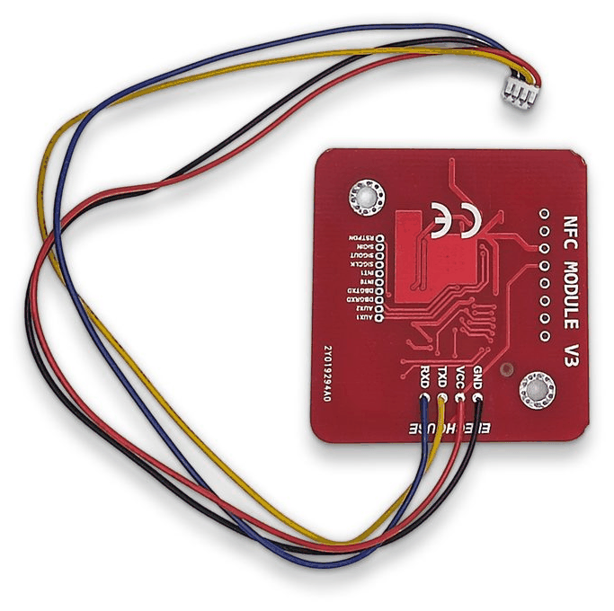
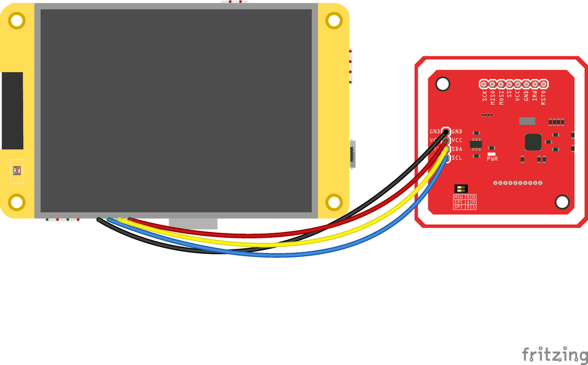
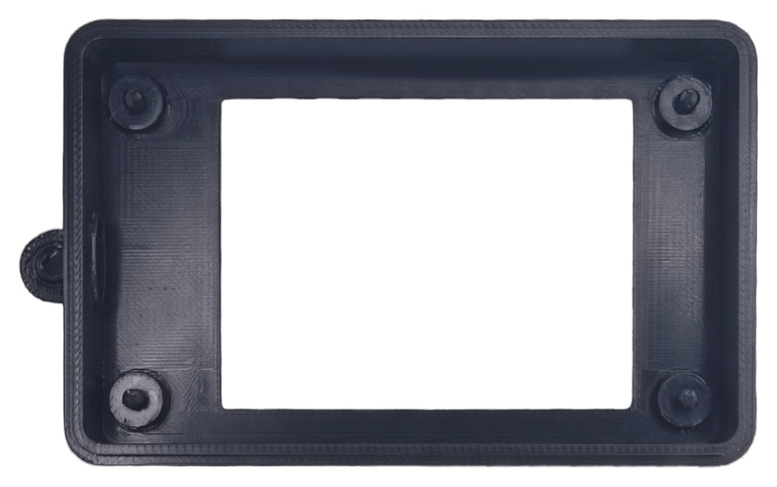
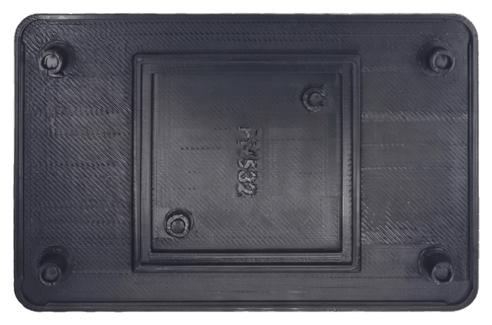
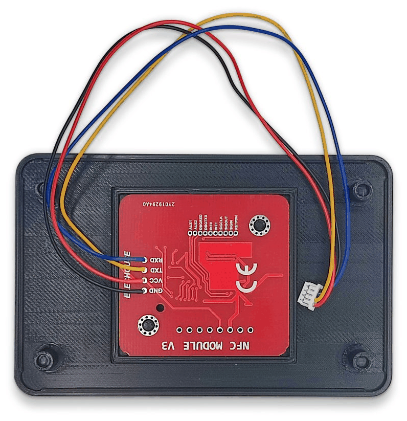
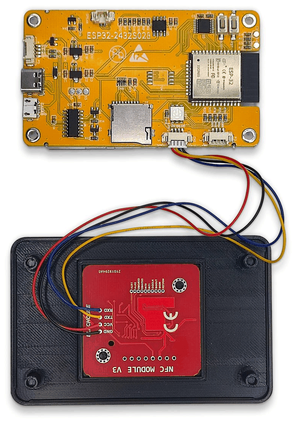
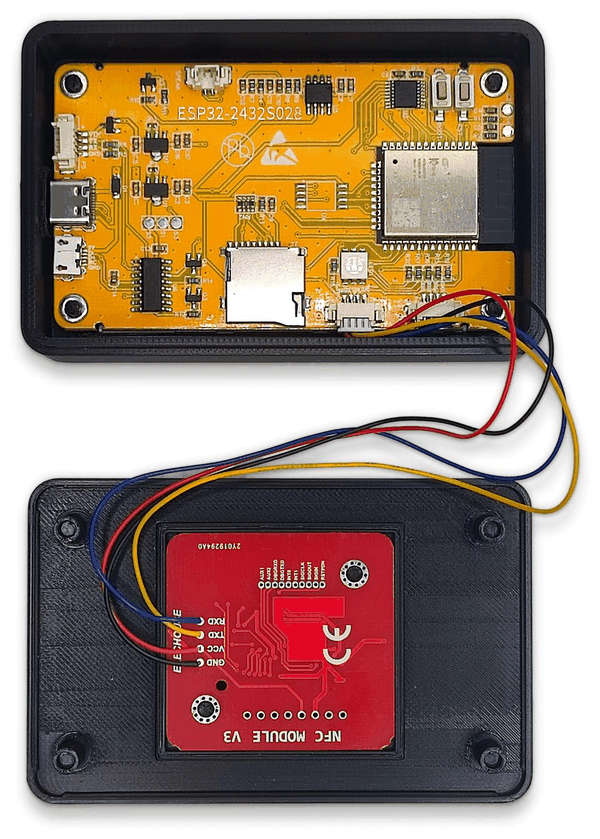
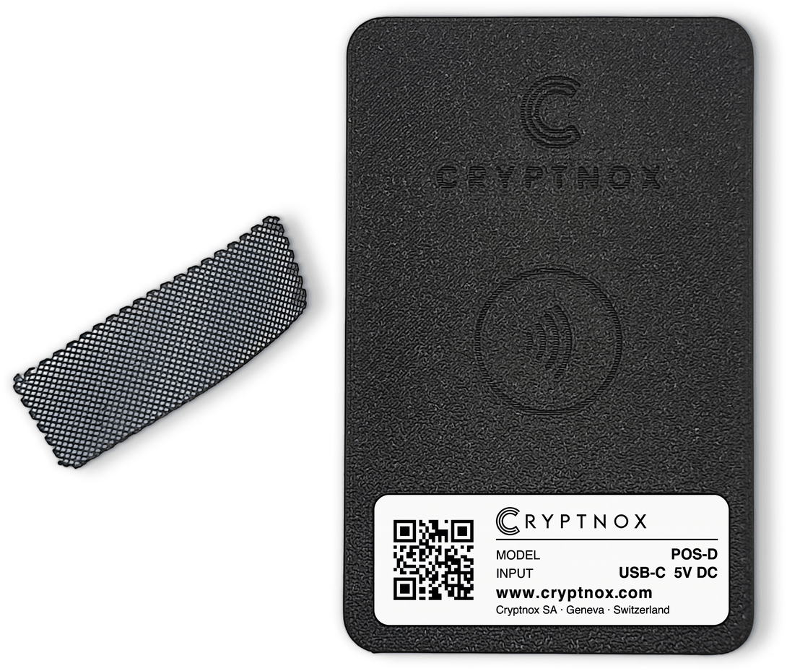
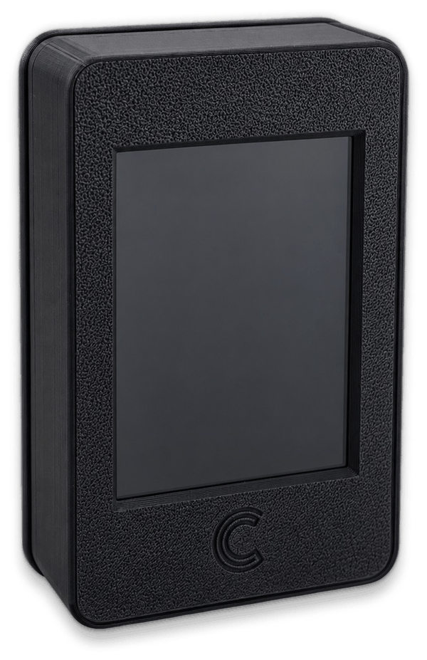

:description: Build a Cryptnox POS terminal: wiring the PN532 NFC module to the ESP32 Cheap Yellow Display and closing them into the printed snap-fit enclosure.

=======================
Assembling the terminal
=======================

A 2.8-inch ESP32 display board and an NFC reader, into a two-part printed
snap-fit shell. Seven steps, one soldering job, no fasteners.

What you need
-------------

The middle column is what to type into AliExpress, Amazon or your usual distributor;
the right column is what to check in the listing before you pay.

.. list-table::
   :header-rows: 1
   :widths: 22 34 44

   * - Part
     - Search for
     - Check before buying
   * - ESP32 display board
     - ``ESP32-2432S028``
     - The 2.8-inch “CYD”. The marking is printed on the back, next to the ESP32
       module. Two things must match: **USB-C**, not micro-USB — the shell is cut for
       USB-C and a micro-USB board will not fit — and **resistive touch**
       (the listing says XPT2046; capacitive variants exist and the firmware does not
       drive them).
   * - 4-wire harness
     - *comes with the CYD*
     - **Normally in the CYD box**, so you rarely have to buy one. It is a 1.25 mm JST
       plug at one end and bare wires at the other, about 10–20 cm, in black, red,
       yellow and blue — the colours in the table below. Only if yours arrives
       without it: search ``JST 1.25mm 4 pin single end cable``.
   * - USB-C cable
     - *comes with the CYD*
     - **In the box as well.** If you use one of your own instead, make sure it is a
       **data** cable and not charge-only: the same cable powers the terminal and
       flashes it.
   * - PN532 NFC module
     - ``PN532 NFC module V3``
     - The square red board. Any V3 clone works, but it **must have the two mode DIP
       switches** — the versions without them are fixed to SPI and cannot do I²C.
   * - Printed shells
     - *nothing to buy — print them*
     - **The two halves are ready-to-print files in this project's repository**:
       `hardware/case/
       <https://github.com/cryptnox/cryptnox-pos/tree/main/hardware/case>`__ —
       ``case_front.stl`` and ``case_back.stl``, or
       ``case_plate.3mf`` for both on one plate. Print in PLA or PETG. They snap
       together, so they have to come out dimensionally accurate — an over-extruded
       lip will not clip. **No 3D printer?** The files go to an online printing
       service or a local maker space as they are. See :doc:`hardware` for what each
       file contains.

You also need a **Cryptnox Hardware Wallet card** to pay with, running applet v1.6.0
or later. Buy it directly from the
`Cryptnox store <https://shop.cryptnox.com/>`__.

Tools: a soldering iron and solder for the four wires, and a thin blade if you ever
want to open the shell again.

Assembly
--------

Wire the NFC module
~~~~~~~~~~~~~~~~~~~

* Set the mode switches to I²C first. They are awkward to reach once the wires are on.
* Solder the four wires to the pad header, following the wiring table.
* Leave about 10 cm of slack — the module ends up in the other half of the shell.

.. list-table::
   :header-rows: 1
   :widths: 20 45 35

   * - Wire
     - PN532 pad
     - Goes to
   * - Black
     - GND
     - GND
   * - Red
     - VCC
     - 3V3
   * - Yellow
     - SDA — the TXD pad
     - GPIO 27
   * - Blue
     - SCL — the RXD pad
     - GPIO 22

.. important::

   **Set the DIP switches to I²C** before soldering — the two switches go to 1 0, and the silkscreen beside them lists all three modes. The pads keep their serial names (RXD, TXD) whatever the mode is, which is why the table names both.

   The four wires between the CYD's CN1 header and the PN532, by colour.

Lay out the shells
~~~~~~~~~~~~~~~~~~

* Front shell, top: the screen window and the four posts the board sits on. The small
  round nub on the left edge is a support built into the model, not a button — break it off.
* Back shell, bottom: the raised square pocket, marked PN532.

*Supports are not needed on either part if they print window-down and pocket-up.*

Seat the NFC module
~~~~~~~~~~~~~~~~~~~

* Drop the PN532 into the pocket with the component side facing **up**, towards you.
* That puts the antenna coil against the outside of the lid, where the contactless symbol is.
* Route the four wires out over the lip towards the other half.

*Turn the module over and the antenna reads through the board instead of the lid — cards then have to be held on the wrong face, if they read at all.*

Plug the harness in — before the board goes anywhere
~~~~~~~~~~~~~~~~~~~~~~~~~~~~~~~~~~~~~~~~~~~~~~~~~~~~

* With the board still **outside** the shell, plug the JST end into CN1, the left of the two 4-pin connectors, next to the SD slot.
* Red goes to the end nearest the SD slot, then yellow, blue, black.
* Only then move on to the next step.

.. list-table::
   :header-rows: 1
   :widths: 20 45 35

   * - CN1
     - Wire
     - Signal
   * - nearest the SD slot
     - Red
     - 3V3
   * - 
     - Yellow
     - GPIO 27 · SDA
   * - 
     - Blue
     - GPIO 22 · SCL
   * - outermost
     - Black
     - GND

*This is the one ordering that matters in the whole build. Once the board is down in the shell, the connector sits against the wall and there is no room to get a plug onto it — you would have to lift the board out again.*

Lower the board into the front shell
~~~~~~~~~~~~~~~~~~~~~~~~~~~~~~~~~~~~

* Screen down, USB-C lined up with the cutout in the side wall, cable already attached.
* The four PCB holes should sit over the posts without forcing. If one fights you, check the print for stringing on that post.
* Lay the slack along the inside wall, clear of the posts, so nothing is pinched when the shells meet.
* Power it up before closing. It should get past the splash to the welcome screen (or the sale screen on a terminal already set up). **NFC reader not found** means the PN532 is not answering: check the four wires and the mode switches, then unplug and replug USB.

*This is the last point where a wiring mistake costs seconds rather than a full disassembly.*

Snap it shut
~~~~~~~~~~~~

* Line the halves up square, then press around the perimeter until the clips engage all the way round. You should hear them go.
* To open it again, start at the seam on one of the long sides and work a thin blade round — never lever from a corner.
* The contactless symbol on the lid marks where a card is read.
* The back label — model, input rating and a QR code to the site — is in the repository
  beside the shells: `label_POS-D_dymo11355.pdf
  <https://github.com/cryptnox/cryptnox-pos/blob/main/hardware/case/label_POS-D_dymo11355.pdf>`__.
  It is sized for Dymo 11355 stock (19 × 51 mm); print it at 100%.

Done
~~~~

* The screen sits flush in its window and the shell closes with no gap along the seam.
* USB-C on the side is the only opening — it carries both power and firmware updates.

